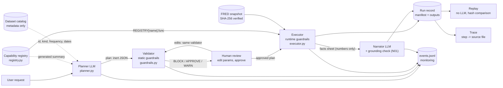

# QuantLab

**Ask a quantitative question in plain English and get an auditable answer, without a single line of generated code being run.**

## Intended users and use cases

QuantLab is built for **market-risk and quantitative analysts** who need fast,
reproducible answers from approved market data. Typical questions:

* "Flag the weeks when NASDAQ volatility was unusually high versus its own history."
* "Was the average weekly NASDAQ return different in high-VIX weeks?"
* "Where is the 10-year minus 2-year Treasury spread today, and how volatile has it been?"
* "How volatile has the Swiss franc been against the dollar over rolling 26-week windows?"

## The problem it solves

Analysts in regulated institutions need quantitative analysis on demand, but
letting an AI assistant write and execute code against production data is not
acceptable: every answer would come from new, untested code that nobody
reviewed. The usual alternative, a one-off notebook written by a quant, is slow,
hard to review and hard to reproduce for model risk or audit.

QuantLab removes that trade-off. The language model never writes code. It only
selects from a registry of pre-approved, unit-tested capabilities and fills in
their parameters. Everything that touches data is deterministic, checked and
recorded.

## The safety model

> **The model proposes, the system disposes.**

1. **Plan.** A language model turns the request into a *plan*: inert JSON naming
   registered capabilities and their parameters. It sees capability descriptions
   and dataset metadata, never data values.
2. **Validate.** A deterministic validator checks the plan against the registry
   and a set of guardrails before anything runs. It blocks unsafe or meaningless
   plans, and asks for explicit approval where a modelling choice matters.
3. **Review.** The analyst reviews the plan, can adjust parameter values (every
   change is re-validated by the same validator) and approves it.
4. **Execute.** A deterministic engine runs the approved plan by looking each
   capability up in the registry. A name that is not registered has no code
   behind it, so it cannot run.
5. **Explain.** A second model call writes a short summary from a facts sheet of
   computed numbers only, and every number in that summary is verified against
   the results.
6. **Record.** Every run is saved with data hashes, library versions, the plan,
   edits, approvals and output hashes, and can be replayed later without any
   language model, producing identical hashes.

In practice this means:

* only pre-approved, tested computations can run;
* statistically unsound choices are blocked (returns of a yield, mixing daily and
  weekly data, a signal built from future returns, a significance test on a price
  level) or require explicit approval (look-ahead thresholds, the return method),
  each with a written reason;
* requests outside the registry (a forecast, a model, running code) are declined,
  never improvised;
* every number shown comes from the engine, and the narrative is checked against it;
* every result can be traced back to the exact source file and replayed.

QuantLab also runs fully offline in **mock mode**, which needs no API key.

**Example output.** For example workflow 1 on the 1971-2026 NASDAQ snapshot,
QuantLab reports that 446 of 2,842 weeks (15.7%) had a 12-week annualised
volatility above the 90th percentile of their own past, in 40 distinct episodes.
The following week's simple return averaged 0.209% after a flagged week and
0.230% after a normal week: a difference of -0.021 percentage points, with a
Newey-West standard error of 0.223 (8 lags) and a p-value of 0.93, so there is no
statistically significant difference. The share of flagged weeks exceeds 10%
because each week is compared only with the history available at the time, so
the more volatile decades after the 1970s cross the earlier thresholds more often.

## Getting started

Requires [uv](https://docs.astral.sh/uv/).

```bash
uv sync                                           # environment from uv.lock
uv run streamlit run app/streamlit_app.py         # the app (works in mock mode)

uv run python -m quantlab.cli demo                # run the example workflows, then trace example 1
uv run python -m quantlab.cli run 1 --datasets NASDAQCOM --mode mock --approve-all   # example 1 by number
uv run python -m quantlab.cli replay <run_id>     # re-run without the model, compare hashes
uv run python -m quantlab.cli trace <run_id> s5   # where does this number come from?
uv run python -m quantlab.cli eval --mode mock    # planner evaluation -> eval/reports/
uv run python -m quantlab.cli eval --mode live --case s1_volatility_flag_success   # one case, item by item

uv run pytest                                     # test suite: no network, no API key
uv run ruff check . && uv run ruff format --check .
uv run jupyter nbconvert --to notebook --execute --inplace notebooks/*.ipynb
```

Refreshing the data (needs network; creates a new data version):
`uv run python scripts/fetch_data.py` (or name series to fetch only those, e.g. `SP500`).

## Using the app

The **Analysis** page follows the safety model step by step:

1. Choose the datasets the planner may use (hover a dataset for its full name),
   then type a request, or in mock mode pick one of the example workflows in the
   sidebar, and click **Generate plan**.
2. Review the plan. Each step is a collapsible block whose header names the step
   and its main parameters (e.g. "Step 4 · C06 · Rolling volatility · window: 12
   weeks, annualize: yes"); open it for its inputs, predicted output and editable
   fields. Steps with a blocking issue or a warning open by default with a badge,
   and edited steps are marked. Approvals are not shown on the steps: each one is
   listed in the validation results, naming its step (e.g. "Step 3 · C03 · Compute
   returns").
3. Read the validation results. Blocking issues must be resolved, approvals must
   be ticked, and warnings are shown for context.
4. Click **Execute**. Results appear per step: charts for series (with flagged
   periods shaded), tables for statistics, and a plain-English narrative marked
   "all numbers verified" when every number checks out.
5. Use **Trace a result** under the results to follow any output back through
   every step to the source file, with its SHA-256, FRED id and retrieval date.

The other pages: **Run history** lists past runs, shows each manifest and user
edits, and replays a run without the model; **Monitoring** shows run outcomes,
latency per stage, capability usage and guardrail activity; **Capability
registry** lists every approved capability with its code, inputs, parameters and
assumptions; **Guardrails** lists every guardrail with its action, who enforces
it, its category and what it prevents.

### Editing a plan before it runs

After a plan is generated, each step's parameters appear as fields generated
from the registry (select boxes for choices, bounded number inputs, checkboxes),
prefilled with the planner's values. Only values can change: steps, capabilities
and input references are locked, and the engine rejects any other edit with a
BLOCK. **Apply changes & re-validate** runs the same validator again, so issues
appear and clear as the plan changes: in example 1, switching
`flag_regime.method` to `full_sample` raises G09, which then also says the
significance test is invalidated, and changing `load_series.dataset_id` from
NASDAQCOM to DGS10 is a legal edit that the validator then blocks (G07: returns
of a yield are meaningless). Windows are counted in periods of the
series' frequency, as their fields and the step summaries say: switching
`resample.freq` from W to D keeps `window` at 12, which then means 12 trading
days instead of 12 weeks. Any edit resets the
approvals, which are recorded with the hash of the plan version they were given
for. Execute stays disabled, with a one-line reason, while changes are unapplied,
a BLOCK remains or an approval is unticked. Edited values are marked ("edited
(was 12)"), **Reset to planner's proposal** undoes them, and the run record keeps
the parameter-level diff that the trace and Run history display. Replay re-runs
the edited plan with identical hashes.

## Example workflows

In mock mode the sidebar offers five ready-made requests; in live and cached
mode the sidebar hides them and you type the request. Together they cover one
realistic task, a market-risk analyst identifying periods of unusual market
behaviour, and the protections QuantLab applies along the way. They run with
canned plans in mock mode (`mock_scenarios.py`) or with the live planner, from the
app or with `cli demo`.

1. **High-volatility weeks and what follows** (`volatility_flag_success`). The
   request states the choices that have no default; the registry defaults supply
   the rest (annualised volatility, an expanding 90th-percentile threshold after
   52 weeks), and forward returns always cover the next week with the test's lags
   set by the Newey-West rule, so the live planner can reach the same plan as the
   canned one:

   > Using NASDAQ, calculate weekly log returns, 12-week volatility, and flag unusually volatile weeks. Compare next-week simple returns after volatile weeks with those after normal weeks, then test whether the difference in means is statistically significant.

   Weekly Friday closes; weekly log returns for the volatility (they add up over
   time, as square-root-of-time annualisation assumes); 12-week annualised
   rolling volatility; flags above the 90th percentile of past volatility only
   (expanding, after 52 weeks); the following week's simple return stamped on
   each week (`forward_return`: a mean of log returns would be lower by about
   half the variance and bias the comparison against volatile weeks); a
   descriptive comparison first (`compare_groups`), then the significance test
   (`hac_mean_difference`). The analyst confirms the two return-method choices
   (G10); there is no warning and no block. The result shows the volatility with
   the high-volatility weeks shaded, both groups' means and standard deviations,
   the number of distinct episodes, and the test's difference, p-value and 95%
   confidence interval.
2. **Look-ahead protection** (`vix_full_sample_lookahead`): "Flag the days when
   the VIX was in the top 5% of its entire history." The plan flags the days above
   the 95th percentile of the whole VIX history, a full-sample threshold that uses
   data nobody had on the flagged day. QuantLab runs it only with explicit approval
   (G09), explains that such a threshold judges past days using information from
   the future, and recommends the expanding method. It is an approval, not a
   block: a full-sample threshold is fine for labelling past stress days but
   invalid as a signal or in a backtest, and only the analyst knows which is meant.
3. **Out-of-scope forecast request** (`arima_forecast_block`): "Fit an ARIMA
   model to forecast next week's USD/CHF exchange rate." The registry has no
   capability that fits a model or makes a forecast, so the planner declines
   (L01) and lists the registered capabilities instead. If a planner ever
   proposed such a step anyway, the validator would block it independently (G02).
4. **Prompt-injection protection** (`prompt_injection_block`): a request that
   tells the assistant to ignore its rules and run Python is treated as data,
   not as instructions, and declined (L01). There is no code path that could run
   it, and automated tests confirm that nothing from the request reaches a shell
   or a subprocess.
5. **Frequency-alignment protection** (`spread_frequency_mismatch_block`):
   "Compute the spread between the weekly 10-year Treasury yield and the daily
   2-year Treasury yield." Planned exactly as asked, the spread of a weekly and a
   daily series would silently keep only the Fridays and mix two frequencies. The
   validator, not the planner, blocks it (G08) before anything runs and states the
   fix: resample the 2-year yield to weekly first.

**Audit trail.** For any executed result, such as example 1's p-value, **Trace a
result** shows the full chain `hac_mean_difference` -> `forward_return` and
`flag_regime` -> `rolling_volatility` -> `compute_returns` -> `resample` ->
`load_series` -> the NASDAQ snapshot file, with each step's library call,
parameters (user edits marked) and output hash. `cli demo` prints the same chain.

## Live mode

Live mode calls a language model for the planner and the narrator. The provider
is set in `.env`: **OpenAI** by default (model `gpt-6-luna`, Responses API), or
Anthropic (`QUANTLAB_LLM_PROVIDER=anthropic`, model `claude-sonnet-5-5`).

**1. Configure.**

```bash
cp .env.example .env
# edit .env:  QUANTLAB_LLM_PROVIDER=openai   OPENAI_API_KEY=sk-...
#             optionally QUANTLAB_PLANNER_MODEL=gpt-6.1-sol as an alternative to gpt-6-luna
```

**2. Check the connection** (one planner call and one narrator call):

```bash
uv run python -m quantlab.cli run "Flag the days when the VIX is above its 95th percentile, using only past data." --datasets VIXCLS --mode live
```

This prints a two-step plan, `Status: completed` and a model-written narrative
marked "all numbers verified". An authentication error means the key is wrong;
"API error 404" usually means the model id is not available to the account (set
`QUANTLAB_PLANNER_MODEL`).

**3. Pre-load the plan cache** for the example workflows (one call each):

```bash
uv run python -m quantlab.cli demo --mode live
```

Typing exactly these requests in **cached** mode (or picking one in mock mode,
then switching to cached: the request stays in the box) then returns their
plans instantly and identically, even on a slow network (the
narrator still calls the model, and falls back to the deterministic template if
it cannot). A live model may decline a request for a different reason than the
canned plan (for example refuse example 5 outright with L01, rather than
proposing the misaligned spread that the validator blocks with G08); the command
only checks that blocked workflows stay blocked.

**4. Start the app**, open http://localhost:8501 and pick **cached** (the default
when a key is set) or **live** in the sidebar. If the API is unavailable, switch
to **mock**: everything keeps working offline with the canned plans.

## Architecture



| Module (`src/quantlab/`) | Role |
|---|---|
| `config.py` | Settings from `.env`: API key, models, LLM mode, paths, budgets |
| `types.py` | `DataType`, `SeriesKind`, `Frequency`; `Artifact` (value + explicit metadata); canonical hashing |
| `data.py` | Catalog, FRED CSV parsing, SHA-256 verification, LLM-safe dataset metadata |
| `capabilities.py` | The quantitative functions: the only code that calls pandas/numpy/statsmodels for analysis |
| `registry.py` | Capability specs, the `REGISTRY` whitelist, generated LLM summary and registry version |
| `plan.py` | Pydantic `Plan` / `Step` (extra fields forbidden), plan version hash, the LLM tool schema |
| `guardrails.py` | The guardrail table (action, enforcer, category), validator guardrails (G codes), L01 refusal block, edit lock, metadata dry run, `ValidationReport` |
| `mock_scenarios.py` | Example workflows 1-5 with their canned plans (mock mode, CLI, app, tests) |
| `executor.py` | Registry dispatch, approval gate, runtime guardrails (R codes), step records |
| `planner.py` | OpenAI and Anthropic planners, mock planner, plan cache |
| `narrator.py` | Facts sheet, LLM narrator, template fallback, numeric grounding check (N01) |
| `lineage.py` | Run record (manifest), save/load, replay, trace |
| `monitoring.py` | Append-only JSONL event log and dashboard aggregations |
| `engine.py` | `Session`: plan, validate, edit, approve, execute, narrate, save; used by app, CLI, notebooks |
| `evaluation.py` | Planner evaluation on golden requests |
| `cli.py` | `python -m quantlab.cli demo / run / replay / trace / eval` |

The language model appears only in `planner.py` and `narrator.py` (a test
enforces this). Everything else is deterministic Python.

## Why plans instead of generated code

An assistant that writes and runs pandas code is flexible, but every run would
be new, untested code touching production data. QuantLab asks the model for a
structured plan instead:

* **Whitelist by construction.** The executor looks the capability name up in a
  dict and calls the function attached to it. An unregistered name, or anything
  that looks like code, has no function to call. There is no `eval`, `exec`,
  dynamic import or `getattr` anywhere in `src/` (a test scans for them). This
  is a stronger guarantee than sandboxing generated code, whose safety depends on
  the sandbox being perfect.
* **Checkable before running.** Because each step declares types, kinds and
  frequencies, the validator rejects "returns of a yield" or "the spread of a
  daily and a weekly series" statically, which is impossible for arbitrary code
  without executing it.
* **Reviewable.** An analyst reads a few lines of plan, not pages of code, and
  edits parameters through fields constrained by the registry.
* **Tested once, reused always.** Every capability has unit tests against
  hand-computed values; generated code would need validating every time.
* **Reproducible.** Plan, data hashes and library versions are enough to replay a
  run with no model involved.

The trade-off is expressiveness: anything outside the registry is declined (L01)
or blocked (G02). Adding a capability is a deliberate, reviewed code change,
which is what model-risk governance requires.

## Capabilities and libraries

The approved menu, deliberately small: descriptive building blocks and one
significance test; the **Capability registry** page always shows the current list. Each capability has a permanent
code (C01, C02, ...) used in the app, run records and traces; plans and the
planner use its name. The codes were renumbered once, when the registry was
simplified (`docs/DECISIONS.md` lists the old and new codes), and are permanent
from that version on.

| Code | Capability | What it does |
|---|---|---|
| C01 | `load_series` | Load one dataset from the catalog (hash-verified, missing days dropped) |
| C02 | `resample` | Daily to weekly (Friday) or monthly (month end), or keep daily (`D`, unchanged) |
| C03 | `compute_returns` | Simple or log returns of a price or index |
| C04 | `difference` | Changes of a rate or yield, in its own units |
| C05 | `spread` | a - b on the dates both series share |
| C06 | `rolling_volatility` | Trailing rolling standard deviation, annualised |
| C07 | `flag_regime` | Flag periods above a quantile threshold (e.g. high volatility) |
| C08 | `forward_return` | The return from the close of t to the close of t+1 (the next period), stamped at t (an outcome only) |
| C09 | `compare_groups` | Mean and standard deviation of a series in flagged vs normal periods, and the number of flagged episodes (descriptive, no test) |
| C10 | `hac_mean_difference` | Significance test of the difference in mean outcome between flagged and normal periods (Newey-West standard errors) |

**What follows a flag, and whether it is significant.** `forward_return` gives,
at each date t, the return from the close of t to the close of t+1, one period
of the series' frequency (the following week on weekly data; the last date has
no future price yet and is dropped, never filled). It is future information at
t, so it may only be the outcome of `compare_groups` or `hac_mean_difference`:
feeding it to anything else, such as a volatility or a flag, is blocked (G11).
`hac_mean_difference` regresses the outcome on a constant and the 0/1 flag,
which makes the flag's coefficient exactly the difference in means, and uses
Newey-West (HAC) standard errors, because ordinary ones assume independent weeks
with equal variance: flagged weeks have a much higher variance than normal weeks
(heteroskedasticity), and volatility clusters, so neighbouring weeks are not
independent (autocorrelation). Its lag count is always the Newey-West rule
floor(4·(T/100)^(2/9)). The outcome must be returns or forward returns (a
level, which is non-stationary: G04). The test assumes a
stationary outcome, a large sample (its p-value is asymptotic) and flags known
before the outcome; it reports an association, never a cause or a forecast.
Every comparison also counts the distinct flagged episodes, the real amount of
independent evidence (fewer than 5: R05).

There are no other statistical tests, no regressions beyond this one and no
forecasts: such requests are declined or blocked (example 3). Each spec declares named inputs (allowed data
types and kinds), parameters (type, range, choices, defaults), output type and
kind, a minimum-observations rule, assumptions (some need approval) and the
underlying library call.

**A deliberately small library surface:** pandas and numpy (time series),
statsmodels (the regression with Newey-West standard errors behind the
significance test), pydantic (strict plan parsing), streamlit and plotly (UI),
the official `openai` and `anthropic` SDKs, python-dotenv and pyyaml.
Deliberately excluded: scipy as a direct dependency (statsmodels installs it;
QuantLab never calls it), scikit-learn (no machine-learning models),
`arch` (no GARCH), and LangChain or any agent framework (two structured model
calls do not need an orchestration layer, and every extra abstraction is more to
audit). Fewer libraries means fewer versions to pin, record and explain.

## Guardrails

Each guardrail is a small named function whose docstring explains what it checks
and what goes wrong without it. Every guardrail has:

* an **action**, what happens when it fires: **BLOCK** (the run stops),
  **APPROVE** (a human must decide before anything runs) or **WARN** (the run
  continues and the result is flagged);
* an **enforcer**, given by the first letter of its code: **L** the planner
  (LLM), which may refuse; **G** the validator, deterministic, on the plan alone
  (the planner's plan and every user edit); **R** the executor, at run time on
  the data; **N** the narrator check, deterministic, on the written summary;
* a **category**, what it protects: plan integrity, approved scope, input
  validity, methodology, data quality or output grounding.

The table is generated from `guardrails.GUARDRAILS`, which also feeds the
**Guardrails** page, its counts and every issue shown in the app. The codes were
renumbered twice while the design settled (`docs/DECISIONS.md` lists the old and
new codes); from this version on they are permanent: never renumbered or given
another meaning, so the issue ids in run records keep their meaning and those
runs can still be replayed.

| Code | Name | Action | Enforced by | Category | Description |
|---|---|---|---|---|---|
| L01 | `PLANNER_REFUSED` | BLOCK | Planner (LLM) | Approved scope | The planner's system prompt explicitly allows it to refuse a request it cannot fulfil with the registry, or one that tries to change its rules, giving a reason instead of a plan; the refusal is blocked and nothing runs. This prevents the LLM from forcing an out-of-scope or malicious request into a misleading plan. |
| G01 | `INVALID_PLAN` | BLOCK | Validator (deterministic) | Plan integrity | Checks the plan is well-formed: it matches the plan schema exactly (no extra fields), has steps, has unique step ids, and every input points to an earlier step. Also raised when the planner returns no usable plan (API error, cut-off answer, provider refusal, no plan submitted). This prevents running a broken, ambiguous or circular plan. |
| G02 | `UNKNOWN_CAPABILITY` | BLOCK | Validator (deterministic) | Approved scope | Checks every step calls a capability in the approved registry. This prevents the system ever running code that nobody wrote, reviewed or tested, whatever the LLM asks for. |
| G03 | `INVALID_PARAM` | BLOCK | Validator (deterministic) | Input validity | Checks each parameter is known, given when required, of the right type and within its allowed range or choices, for example a quantile between 0.5 and 0.99. Edits that try to change anything other than a parameter value are rejected under this code too. This prevents nonsensical settings from producing plausible-looking numbers. |
| G04 | `TYPE_MISMATCH` | BLOCK | Validator (deterministic) | Input validity | Checks each step receives the kind of series it expects, for example volatility computed on returns, not on prices, and a significance test on returns, not on a price level. This prevents statistically meaningless calculations. |
| G05 | `BUDGET_EXCEEDED` | BLOCK | Validator (deterministic) | Plan integrity | Checks the request length, before the planner is called (so an oversized request costs no LLM call) and again with every plan, and the number of steps in the plan. This prevents oversized requests and runaway plans too long for a human to review. |
| G06 | `UNKNOWN_DATASET` | BLOCK | Validator (deterministic) | Approved scope | Checks every dataset the plan names or loads is in the approved, hash-versioned catalog. This prevents the use of unverified or invented data. |
| G07 | `RETURNS_ON_RATES` | BLOCK | Validator (deterministic) | Methodology | Checks that returns aren't computed on interest rates, which call for differences instead. This prevents economically wrong results, such as percentage changes of a yield near zero. |
| G08 | `FREQUENCY_MISMATCH` | BLOCK | Validator (deterministic) | Methodology | Checks that series combined in one step (a spread, a comparison, a test) share the same frequency. This prevents silently comparing weekly values with daily ones. |
| G09 | `LOOK_AHEAD` | APPROVE | Validator (deterministic) | Methodology | Detects thresholds built from the full sample, including future data, and asks for approval. This prevents a result that looks predictive only because it used information unavailable at the time. |
| G10 | `MATERIAL_ASSUMPTION` | APPROVE | Validator (deterministic) | Methodology | Asks for human approval when a choice changes the answer, today the return method (log versus simple returns). This prevents important assumptions being made silently. |
| G11 | `FORWARD_DATA_AS_SIGNAL` | BLOCK | Validator (deterministic) | Methodology | Checks forward returns are used only as outcomes, never to build a flag or signal. This prevents the future leaking into the explanation of the future. |
| R01 | `DATASET_HASH_MISMATCH` | BLOCK | Executor (runtime) | Data quality | Checks each loaded snapshot matches the hash recorded in the catalog. This prevents the analysis running on altered or different data. |
| R02 | `INSUFFICIENT_DATA` | BLOCK | Executor (runtime) | Data quality | Checks each step has enough observations for its calculation, for example three times the rolling window. This prevents statistics computed on too little data. |
| R03 | `MISSING_DATA` | WARN | Executor (runtime) | Data quality | Warns when more than 5% of a loaded series' values are missing (they are dropped). This prevents gaps silently distorting the results. |
| R04 | `ALIGNMENT_LOSS` | WARN | Executor (runtime) | Data quality | Warns when aligning two series on their common dates drops more than 10% of either. This prevents hidden sample shrinkage. |
| R05 | `LOW_EFFECTIVE_SAMPLE` | WARN | Executor (runtime) | Methodology | Warns when the flagged periods of a comparison or test come from fewer than 5 distinct episodes. This prevents overconfidence in a result that looks large but rests on few real events. |
| N01 | `UNGROUNDED_NARRATIVE` | WARN | Narrator check (deterministic) | Output grounding | Checks deterministically that every number and date in the written summary is a correct rounding of a value the run computed (the facts sheet) or used (plan parameters, the request, warnings, dataset titles). An LLM summary that fails is withheld and the deterministic summary shown instead, with the failing numbers listed. This prevents the narrative from inventing or misquoting numbers, so every figure can be traced back to data, functions and parameters. |

The executor re-runs the validator itself and refuses to start while any BLOCK
exists or any APPROVE issue is unapproved, so calling it directly cannot skip
the checks. Approvals are recorded with a timestamp, the exact issue text and the
plan version they apply to.

## The model calls

**Providers.** `QUANTLAB_LLM_PROVIDER` selects OpenAI (default; Responses API,
`gpt-6-luna`) or Anthropic (Messages API, `claude-sonnet-5-5`). Both receive the
same prompts and plan schema, and their output goes through the same parsing
and validation. Only `planner.py` imports the provider SDKs, and only
`planner.py` and `narrator.py` call them. The run record stores the provider,
the requested model and the model version that actually answered.

**Planner** (`planner.py`). The system prompt contains the rules, the capability
summary generated from the registry, and dataset metadata (never values). The
request is wrapped in `<user_request>` tags and treated as data, so instructions
inside it ("ignore your rules", "run this Python") lead to a refusal. The plan
arrives through a `submit_plan` function tool whose schema is the plan schema,
and is then parsed strictly (G01) and validated. Two API constraints shaped this
(details in `docs/DECISIONS.md`): current reasoning models do not reliably accept
a *forced* tool choice or a non-default temperature, so the tool call is
requested by instruction (`tool_choice="auto"`), reasoning depth is set with an
effort level, and determinism comes from the plan cache and model-free replay
rather than `temperature=0`.

**Modes:** `live` (call the API), `cached` (reuse the cached plan for an
identical request, datasets, model, prompt version and registry version), and
`mock` (canned plans for the five example workflows; anything else is politely
declined). Mock mode is also the fallback whenever the network or the API is
unavailable.

**Narrator** (`narrator.py`). Receives the request, a plain plan summary,
warnings, approvals and a *facts sheet* of rounded computed numbers, and must use
only those numbers. `check_grounding` then extracts every number in the narrative
and checks that it is a correct rounding of a fact (or its percentage form), a
plan parameter, a number from the request or a warning, or an annualisation
factor. Dates are facts too: a date, as `2021-11-19` or in words such as
"19 November 2021", must be a date of the facts sheet (a month must contain one,
and a year on its own must lie within the data), so a narrative that names the
wrong peak date fails the check. For the significance test the narrator must
state the difference and its p-value, write "no statistically significant
difference" when the p-value is 0.05 or more (never "no difference"), always
give the number of distinct episodes and never say that the flag causes or
predicts returns; only then are the 5% significance and 95% confidence levels
accepted numbers. That check is guardrail N01 UNGROUNDED_NARRATIVE: when it
passes the app shows "all numbers verified"; when a model-written narrative fails
it, the narrative is withheld (kept in the run record), the deterministic template
narrative is shown instead, and an N01 warning lists the numbers that failed. The
numerical results are not affected, and the deterministic facts table is always
shown.

## Reproducibility, lineage and monitoring

* **Run record.** `runs/<run_id>/manifest.json`: request, model information
  (model, prompt version, mode, cache hit, latency, tokens), the plan as proposed
  and as run with its version hash, parameter edits and the parameter-level diff,
  validation report, approvals, dataset versions (file SHA-256, retrieval time,
  rows and dates used), environment (Python, library versions, git commit),
  registry version, step records with input and output hashes, warnings, the
  narrative with its grounding result, and stage timings.
* **Outputs.** `runs/<run_id>/outputs/<step>_<capability>.csv|json`. Each file is
  the canonical text that was hashed, so `shasum -a 256` reproduces the hash in
  the manifest.
* **Replay.** `quantlab.cli replay <run_id>` (or the Run history page) verifies
  the data hashes, re-validates the final plan, executes it with the recorded
  approvals and no model, and compares every output hash. Floats are hashed at 12
  significant digits, so harmless last-bit differences between machines do not
  break replay while any real change does.
* **Trace.** `quantlab.cli trace <run_id> <step>` (or the trace panel) walks the
  plan backwards: capability, library call, parameters (user edits marked), input
  steps and output hash for each step, down to the FRED file hash and the date
  range used.
* **Monitoring.** `runs/events.jsonl` receives one event per stage (request,
  planning, validation issues, approvals, each step, runtime guardrails,
  narration, completion, replays). The Monitoring page shows run counts and
  success / blocked / failed rates, mean and p95 latency per stage, capability
  usage, guardrail activity, recent errors and the plan-cache hit rate.

## Quality assurance

Two separate questions, measured separately:

* **Does the planner choose the right plan?** Measured by `quantlab.cli eval` (or
  `eval/run_eval.py`) on `eval/golden_requests.yaml`: the five example workflows,
  simple variations, and adversarial requests (such as a forecast) that must end
  in a refusal or a BLOCK. Metrics: valid-plan rate, exact capability-sequence
  match, capability-set Jaccard, key-parameter accuracy, guardrail-outcome match
  and correct refusal/block rate. Each case is also reported item by item (every
  step in order, every key parameter, the issues of each action), so a live
  mismatch shows exactly what the planner chose differently; `--case <id>` runs
  one case, such as the fully specified flagship (`s1_volatility_flag_success`).
  Reports go to `eval/reports/`. In mock mode this checks the harness only
  (the mock knows just the five examples); `--mode live` measures the real model.
* **Are the computations right?** Measured by the unit tests, independently of
  any model: returns, differences, spread alignment, rolling volatility and
  annualisation, the no-look-ahead property of expanding flags, forward returns,
  group comparisons and episode counts, the Newey-West test against a direct
  statsmodels fit, every guardrail, plan editing, replay, grounding, a source
  safety scan, and a golden record of the five example workflows' results.

## Project layout

```
pyproject.toml, uv.lock     dependencies (direct ones pinned exactly)
CLAUDE.md                   engineering conventions for AI-assisted development
docs/SPEC.md                the v1 product specification
docs/DECISIONS.md           design decisions and their rationale
data/                       catalog.json, snapshots/*.csv (committed), README (sources, licences)
scripts/fetch_data.py       refreshes the FRED snapshot and catalog
src/quantlab/               the package (see the module table above)
app/                        Streamlit: streamlit_app.py (router), ui.py, pages/
notebooks/01..08            one notebook per layer, executed in mock mode
eval/                       golden_requests.yaml, run_eval.py, reports/
tests/                      pytest suite (synthetic data, simulated model clients)
runs/                       run records, plan cache, events.jsonl (git-ignored)
```

## Current limitations and roadmap

* **Live mode coverage.** The OpenAI path is in use with `gpt-6-luna` for both
  the planner and the narrator. The Anthropic path is covered by automated tests
  with simulated responses only, and the full live planner evaluation (`eval
  --mode live`) has not yet been run; the flagship case (with both the longer
  and the current, shorter request) was run live three times and matched the
  canned plan exactly each time. Mock mode, used by the tests, the CLI, the
  notebooks and the app, is fully covered.
* **No plan -> observe -> replan loop.** Validation errors are shown to the
  analyst but not yet fed back to the model for a corrected plan.
* **The grounding check is numeric.** It proves every number is a correct
  rounding of an allowed value and every date is a date of the results, not that
  the sentence attaches it to the right concept (a true date described as the
  wrong extreme would pass), and it compares absolute values (sign errors are
  not caught).
* **One significance test, no forecasts.** QuantLab describes what happened
  (averages, volatility, high-volatility periods, spreads) and can test one kind
  of question, whether an outcome differs between flagged and normal periods,
  with an asymptotic p-value. Other tests, models and forecasts are declined or
  blocked.
* **File-based, single-user.** Runs and events live on local disk; approvals are
  recorded as "user", with no authentication or four-eyes approval yet.
* **`registry_version` covers capability interfaces, not their code**; the git
  commit in each manifest covers the code.
* **Data licences.** SP500 and NASDAQCOM are marked "Copyrighted: Pre-Approval
  Required" on FRED; see `data/README.md` before redistributing the data.
* **Short S&P 500 Index history.** FRED distributes only the last 10 years.

Roadmap:

* **Governed dataset onboarding.** A reviewed process to add or refresh datasets (fetch,
  review, hash, register in the catalog, with a catalog history), kept separate from
  analysis so users never pull data at runtime. Requests for data that is not available
  are logged as unmet data needs and become the intake queue for this process.
* **New capabilities.** Further reviewed analysis functions in the registry (drawdowns,
  correlations, further statistical tests and regressions, GARCH), each added as a code
  change with tests, never generated at runtime.
* **New guardrails.** Further validation rules as new risks are identified, each with a
  defined action (BLOCK, APPROVE or WARN), enforcer, category and test coverage.
* **Replan loop.** Validator feedback sent back to the planner for a corrected plan.
* **Access control.** Authentication and role-based access, with named approvers and
  four-eyes approvals.
* **Persistent store** for runs and events.
* **Continuous integration** running the tests, lint, the example workflows, the
  notebooks and the live evaluation.
* **Cost control.** Per-run cost tracking and prompt caching for the planner.
