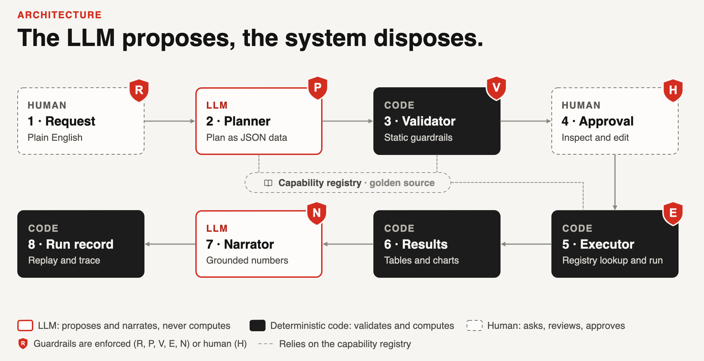

# QuantLab

QuantLab turns a market question asked in plain English into a checked,
human-approved and reproducible analysis. The AI never writes or runs code: it only
chooses among approved, unit-tested capabilities, and every number comes from
deterministic code. It is built for market-risk and quantitative analysts who need
answers they can audit.




## How it works

The planner LLM sees the request, a summary of the capability registry and dataset
metadata (never data values), and returns a plan: inert JSON naming registered
capabilities, or a refusal. The validator checks it against the registry and the
guardrails. A person reviews it, may edit parameter values (re-checked by the same
validator) and approves. The executor runs each step by registry lookup on data
snapshots verified by SHA-256. The narrator LLM summarises the computed numbers, and
a deterministic check verifies every number it writes (N01). Every run is saved, can
be replayed without the LLM and traced to the source file. The LLM proposes, the
system disposes.

One LangGraph graph ([src/quantlab/graph.py](src/quantlab/graph.py)) runs this
pipeline for the app, the CLI and the notebooks: each stage is a node, and the review
is an interrupt where the run pauses, its state checkpointed, until the reviewer
answers.

## Request changes

When a plan needs more than new parameter values (another resampling, a different
step), the reviewer can write a comment and click **Request changes**. The planner
gets the original request, the plan, the guardrail findings (codes and messages,
never data) and the comment, and returns a complete revised plan. The comment gets
the same request check as a request, and the revision goes through every validator
guardrail before the reviewer sees it. Up to 3 change requests per run; after that,
only Execute or Reject. It needs live mode: in mock and cached mode the button is
disabled; otherwise it turns grey once a comment is written and can be sent. A plan
rejected as a whole (V01, V02) ends the run instead. Every revision stays in the one
run record, under its run id: the Analysis page shows the revision number and what
changed, and the trace lists the revision history.

## What's inside

- **Capabilities:** descriptive building blocks plus one significance test, each
  tested against hand-computed values ([table](docs/ARCHITECTURE.md#capabilities)).
- **Guardrails:** each has a code, an action (BLOCK, APPROVE or WARN) and a category:
  plan integrity, approved scope, input validity, methodology, data quality or output
  grounding. Some blocks are fixed by an edit; others reject the whole plan
  ([table](docs/ARCHITECTURE.md#guardrails)).
- **Datasets and hashing:** FRED snapshots, checked against their SHA-256 before
  every load ([data](data/README.md)).
- **Monitoring:** one event per pipeline stage, and a page for activity, review,
  guardrails, cost and latency ([guide](docs/GUIDE.md#reproducibility-lineage-and-monitoring)).
- **Reproducibility and replay:** every run is recorded; replay re-runs it without
  the LLM and compares every output hash
  ([guide](docs/GUIDE.md#reproducibility-lineage-and-monitoring)).
- **Evaluation:** a golden set (the right plan?) and an adversarial set (a refusal
  when, and only when, it should?) ([guide](docs/GUIDE.md#quality-assurance)).
- **LLM modes:** live, cached or mock; mock runs offline with no API key
  ([guide](docs/GUIDE.md#llm-modes)).

## Quick start

Requires [uv](https://docs.astral.sh/uv/).

```bash
uv sync                                     # install
uv run streamlit run app/streamlit_app.py   # the app, at http://localhost:8501
uv run pytest                               # tests (no network, no API key)
```

Without an API key the app starts in mock mode. For live mode, copy `.env.example`
to `.env` and set a key ([guide](docs/GUIDE.md#live-mode)).

## Example requests

Ready-made in the sidebar in mock mode ([details](docs/GUIDE.md#example-workflows)):

1. **Is the Swiss franc a safe haven?** Completed analysis: high-VIX weeks, then a
   test of the next week's USD/CHF return.
2. **Frequency-alignment protection.** Fixable block: a weekly and a daily yield in
   one spread (V08), fixed by editing one frequency.
3. **Out-of-scope forecast request.** Refusal: nothing in the registry forecasts, so
   the planner declines (P01).
4. **Prompt injection.** A simulated planner proposes an unregistered capability;
   the whole plan is rejected (V02) and nothing runs.
5. **Buy the dip in tech?** Completed analysis: the biggest weekly NASDAQ drops, then
   a test of whether the next week differs.

## Roadmap and next steps

Next steps:

- **Governed onboarding:** new datasets, capabilities (for example drawdowns,
  correlations or GARCH) and guardrails, each entering as a reviewed code change with
  tests, never generated at runtime. Declined requests in the event log show what
  users asked for and could not get.
- **Guided loop:** after a block or a result, the planner proposes a fix or a next
  step for the analyst to approve. Every proposal goes back through the validator;
  never an auto-fix.
- **At scale:** the tests, the example workflows and the live evaluation in CI, so
  planner accuracy and block rates are tracked on every prompt, model or registry
  change.

Further on: access control with named approvers and four-eyes approval, a persistent
store for runs and events, multiple-testing control across runs, an approval view
that highlights assumptions and edits, and live data feeds hashed and versioned like
the snapshots. The full roadmap is in
[ARCHITECTURE.md](docs/ARCHITECTURE.md#limitations-and-roadmap).

## Where to look next

| Where | What |
|---|---|
| [docs/GUIDE.md](docs/GUIDE.md) | Using the app and the CLI, the example workflows, LLM modes, monitoring, evaluation |
| [docs/ARCHITECTURE.md](docs/ARCHITECTURE.md) | Safety model, modules, capability and guardrail tables, limitations and roadmap |
| [docs/DECISIONS.md](docs/DECISIONS.md) | Every design decision, with its reason and the alternatives |
| [docs/SPEC.md](docs/SPEC.md) | The original v1 specification |
| [data/README.md](data/README.md) | Datasets, sources, licences and snapshot hashes |
| [src/quantlab/](src/quantlab/) | The package: registry, guardrails, validator, planner, executor, narrator, lineage, and the graph that orchestrates them |
| [app/](app/) | The Streamlit app |
| [notebooks/](notebooks/) | One notebook per layer, run in mock mode |
| [tests/](tests/) | The test suite, with synthetic data and simulated LLM clients |
| [eval/](eval/) | Golden and adversarial request sets, and the evaluation runner |
